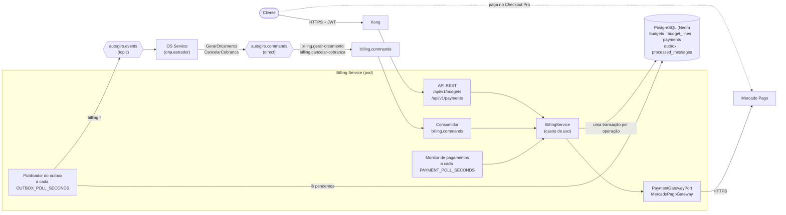
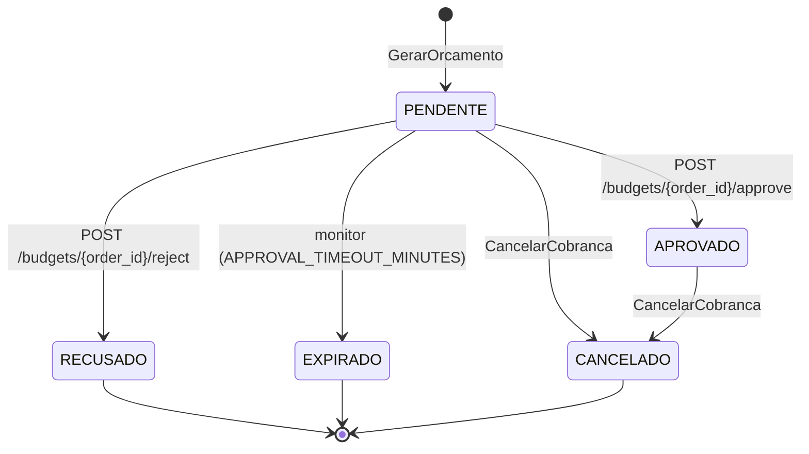
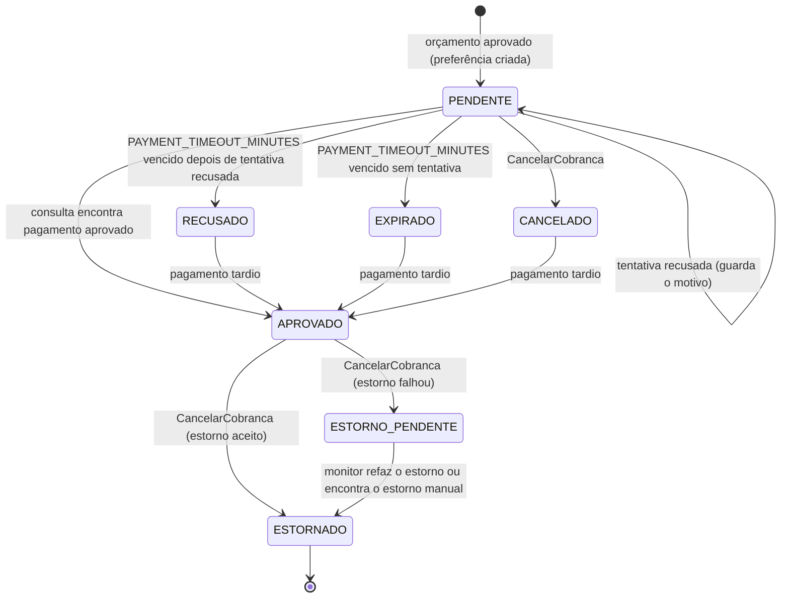

# Arquitetura do Billing Service

O Billing Service é o dono da **cobrança** na plataforma AutoGiro: gera o orçamento de cada
ordem de serviço (OS), registra a decisão do cliente, cobra pelo Mercado Pago (Checkout Pro) e
estorna quando a Saga precisa desfazer uma OS já paga.

Ele é **participante** da Saga orquestrada pelo
[OS Service](https://github.com/Figueiraa/autogiro-os-service): recebe comandos pelo RabbitMQ,
responde com eventos e nunca chama os outros serviços diretamente. A visão geral da plataforma
fica na [documentação do OS Service](https://github.com/Figueiraa/autogiro-os-service/blob/main/docs/README.md).

| | |
|---|---|
| **É dono de** | Orçamentos (`budgets`, `budget_lines`) e pagamentos (`payments`) |
| **Recebe dos outros serviços** | Cópias no comando `GerarOrcamento`: cliente (id, nome, e-mail), serviços e peças com preço |
| **Entrega aos outros serviços** | Total do orçamento, link de pagamento e desfecho do pagamento, sempre por evento |
| **Banco** | PostgreSQL próprio, num projeto Neon só do serviço |
| **Integração externa** | Mercado Pago: API de Preferences (Checkout Pro), busca de pagamentos e estornos |

## Componentes

Tudo roda no mesmo processo: a API (FastAPI), o consumidor de comandos e as duas tarefas
periódicas (publicador do outbox e monitor de pagamentos) sobem juntos no `lifespan` da
aplicação. Sem `RABBITMQ_URL`, só a API sobe; os eventos ficam no outbox até o broker ser
configurado.

O código segue Clean Architecture:

| Camada | Pasta | Conteúdo |
|---|---|---|
| Domínio | `app/domain/` | Entidades `Budget` e `Payment`, com as transições de estado; exceções de negócio |
| Aplicação | `app/application/` | `BillingService` (casos de uso), envelope das mensagens e portas (`PaymentGatewayPort`, `UnitOfWorkPort`, `NotifierPort`) |
| Infraestrutura | `app/infrastructure/` | PostgreSQL (SQLAlchemy assíncrono), migrations, RabbitMQ, adaptador do Mercado Pago, notificação, métricas e rastreamento |
| Interfaces | `app/interfaces/http/` | Rotas, esquemas, autenticação JWT e tratamento de erros |

## Modelo de dados

Schema em [`migrations/`](../migrations/), aplicado por `python -m app.infrastructure.migrations`
(no Kubernetes, por um *init container*). Cada arquivo roda uma vez, em ordem de nome, numa
transação, e fica registrado em `schema_migrations`. Uma trava consultiva do PostgreSQL impede
que duas réplicas apliquem a mesma migration ao mesmo tempo.

`order_id` é o id da OS no OS Service. Não há chave estrangeira para dados de outro serviço:
cliente, serviços e preços são cópias recebidas no comando da Saga.

### `budgets`

| Coluna | Tipo | Observação |
|---|---|---|
| `id` | `SERIAL` | PK |
| `order_id` | `INTEGER` | **Único** (`uq_budgets_order`): um orçamento por OS |
| `saga_id` | `VARCHAR(36)` | Saga que gerou o orçamento |
| `client_id`, `client_name`, `client_email` | | Cópia dos dados do cliente |
| `total` | `NUMERIC(10,2)` | `CHECK (total > 0)` |
| `status` | `VARCHAR(20)` | `PENDENTE`, `APROVADO`, `RECUSADO`, `EXPIRADO`, `CANCELADO` |
| `created_at`, `expires_at`, `decided_at` | `TIMESTAMPTZ` | `expires_at` = criação + `APPROVAL_TIMEOUT_MINUTES` |

### `budget_lines`

| Coluna | Tipo | Observação |
|---|---|---|
| `id` | `SERIAL` | PK |
| `budget_id` | `INTEGER` | FK para `budgets`, `ON DELETE CASCADE` |
| `kind` | `VARCHAR(10)` | `SERVICO` ou `PECA` |
| `reference_id` | `INTEGER` | `service_type_id` ou `part_id` |
| `description` | `VARCHAR(255)` | Nome do serviço ou da peça |
| `quantity` | `INTEGER` | `CHECK (quantity > 0)` |
| `unit_price` | `NUMERIC(10,2)` | `CHECK (unit_price >= 0)`. Preço copiado do comando: se mudar depois, o orçamento não muda |

### `payments`

| Coluna | Tipo | Observação |
|---|---|---|
| `id` | `SERIAL` | PK |
| `budget_id` | `INTEGER` | FK para `budgets` |
| `order_id`, `saga_id` | | Para localizar o pagamento da OS e montar os eventos |
| `amount` | `NUMERIC(10,2)` | `CHECK (amount > 0)` |
| `status` | `VARCHAR(30)` | `PENDENTE`, `APROVADO`, `RECUSADO`, `EXPIRADO`, `CANCELADO`, `ESTORNADO`, `ESTORNO_PENDENTE` |
| `external_reference` | `VARCHAR(60)` | **Única**. `autogiro-os-<order_id>-<12 hex>`: vai na preferência e é a chave da busca de pagamentos |
| `mp_preference_id`, `payment_link` | | Preferência criada no Mercado Pago e o link de pagamento |
| `mp_payment_id`, `status_detail` | | Pagamento encontrado na consulta; motivo da última tentativa recusada ou do estorno pendente |
| `refund_id` | `VARCHAR(40)` | Id do estorno, ou `manual` quando conciliado depois |
| `refund_retryable` | `BOOLEAN` | Estorno pendente por falha temporária: o monitor tenta de novo. `false` na recusa definitiva (estorno manual) |
| `expires_at`, `created_at`, `updated_at` | `TIMESTAMPTZ` | `expires_at` = aprovação + `PAYMENT_TIMEOUT_MINUTES` |

### `outbox` e `processed_messages`

| Tabela | Colunas | Uso |
|---|---|---|
| `outbox` | `id`, `message_id` (único), `message_type`, `exchange`, `routing_key`, `body`, `trace_context`, `created_at`, `published_at` | Eventos gravados na mesma transação da mudança de estado e publicados depois. `trace_context` guarda os cabeçalhos W3C do trace em que o evento nasceu |
| `processed_messages` | `message_id` (PK), `processed_at` | Inbox: comandos já processados |

### Índices

| Índice | Para quê |
|---|---|
| `ix_payments_order (order_id)` | Pagamento da OS |
| `ix_payments_watch (status, updated_at)` | Seleção do monitor (pendentes, estornos pendentes e recém-recusados, expirados ou cancelados) |
| `ix_budgets_pending (expires_at) WHERE status = 'PENDENTE'` | Orçamentos sem resposta com prazo vencido |
| `ix_outbox_pending (id) WHERE published_at IS NULL` | Eventos ainda não publicados |

PostgreSQL porque é dinheiro: aprovar o orçamento, criar o pagamento e gravar o evento
`OrcamentoAprovado` acontecem numa única transação ACID.

## Máquinas de estado

Só o Billing muda estes estados. O OS Service fica sabendo pelos eventos.

### Orçamento

Aprovar ou recusar exige o orçamento `PENDENTE` e dentro do prazo; fora disso a API responde
`422`. Um `CancelarCobranca` sobre orçamento já recusado, expirado ou cancelado não muda nada.

### Pagamento

Uma tentativa recusada não encerra o pagamento: no Checkout Pro o cliente pode tentar outro
cartão no mesmo link até o prazo. O pagamento continua `PENDENTE`, com o motivo da última
recusa em `status_detail`, e só vira `RECUSADO` quando o prazo vence sem pagamento aprovado.

`RECUSADO → APROVADO`, `EXPIRADO → APROVADO` e `CANCELADO → APROVADO` existem porque o cliente
pode concluir o pagamento no último instante e a confirmação chegar depois do prazo. Esse
pagamento é informado à Saga, que manda estornar (ver [Pagamento tardio](#pagamento-tardio)).

## Mensageria

Todas as mensagens usam o envelope definido em
[`app/application/messages.py`](../app/application/messages.py), o mesmo do
[OS Service](https://github.com/Figueiraa/autogiro-os-service/blob/main/app/application/messages.py):
`message_id`, `type`, `kind` (`command` ou `event`), `version`, `saga_id`, `order_id`,
`causation_id`, `occurred_at`, `producer` e `payload`.

### Topologia

| Recurso | Tipo | Uso |
|---|---|---|
| `autogiro.commands` | exchange `direct`, durável | Comandos do orquestrador. Routing key `<serviço>.<comando-em-kebab-case>` |
| `autogiro.events` | exchange `topic`, durável | Eventos dos participantes. Routing key `<produtor>.<evento-em-kebab-case>` |
| `billing.commands` | fila durável | Ligada a `billing.gerar-orcamento` e `billing.cancelar-cobranca` |
| `billing.commands.retry` | fila durável, `x-message-ttl` = `MESSAGE_RETRY_DELAY_MS` (5000) | Espera antes de nova tentativa; ao expirar, a mensagem volta para `billing.commands` pelo exchange padrão |
| `billing.commands.dlq` | fila durável | Destino final de mensagens inválidas ou que falharam em todas as tentativas |

O Billing declara os dois exchanges e as suas três filas ao subir. Publicação com
*publisher confirms*, mensagens persistentes e `prefetch_count = 10` no consumo.

### Comandos consumidos

| Comando | Routing key | `payload` | Efeito | Resposta |
|---|---|---|---|---|
| `GerarOrcamento` | `billing.gerar-orcamento` | `client: {id, name, email}`, `services: [{service_type_id, name, quantity, unit_price}]`, `parts: [{part_id, name, quantity, unit_price}]` | Cria o orçamento `PENDENTE` com uma linha por serviço e por peça e avisa o cliente | `OrcamentoGerado` ou `OrcamentoFalhou` |
| `CancelarCobranca` (compensação) | `billing.cancelar-cobranca` | `reason` | Cancela orçamento e cobrança; estorna se já houve pagamento | `CobrancaCancelada` |

Mensagens de outro tipo que cheguem à fila são registradas como processadas e ignoradas.

### Eventos publicados

Todos vão para `autogiro.events` com routing key `billing.<evento>`.

| Evento | Routing key | `payload` | Quando |
|---|---|---|---|
| `OrcamentoGerado` | `billing.orcamento-gerado` | `budget_id`, `total` | Orçamento criado (ou já existia para a OS) |
| `OrcamentoFalhou` | `billing.orcamento-falhou` | `reason` | OS sem serviços nem peças, preço ausente ou negativo, quantidade menor que 1 ou total igual a zero |
| `OrcamentoAprovado` | `billing.orcamento-aprovado` | `budget_id`, `payment_id`, `payment_link`, `amount` | Cliente aprovou; preferência criada no Mercado Pago |
| `OrcamentoRecusado` | `billing.orcamento-recusado` | `budget_id` | Cliente recusou |
| `OrcamentoExpirado` | `billing.orcamento-expirado` | `budget_id` | Sem resposta dentro de `APPROVAL_TIMEOUT_MINUTES` |
| `PagamentoConfirmado` | `billing.pagamento-confirmado` | `payment_id`, `mp_payment_id`, `amount` | Consulta encontrou pagamento aprovado (inclusive tardio) |
| `PagamentoRecusado` | `billing.pagamento-recusado` | `payment_id`, `mp_payment_id`, `status_detail` | Prazo de `PAYMENT_TIMEOUT_MINUTES` vencido sem pagamento aprovado e com tentativa recusada ou cancelada no Mercado Pago (dados da última recusa) |
| `PagamentoExpirado` | `billing.pagamento-expirado` | `payment_id` | Prazo de `PAYMENT_TIMEOUT_MINUTES` vencido sem nenhuma tentativa de pagamento |
| `CobrancaCancelada` | `billing.cobranca-cancelada` | `estornado`, `refund_id`, `estorno_pendente` | Compensação concluída |

Eventos de resposta a um comando levam `causation_id` igual ao `message_id` do comando.

### Retry e DLQ

O consumidor ([`consumer.py`](../app/infrastructure/messaging/consumer.py)) decide o destino
de cada entrega:

- **Envelope inválido** (JSON malformado, campo obrigatório ausente, `version` maior que a
  suportada): direto para `billing.commands.dlq`.
- **Falha técnica** (exceção no processamento, banco fora): a transação é desfeita e a mensagem vai para `billing.commands.retry` com o
  cabeçalho `x-retry-count` incrementado. Depois de `MESSAGE_MAX_RETRIES` (3) novas
  tentativas, vai para a DLQ com o erro no cabeçalho `x-error`.
- **Falha de negócio** (orçamento inválido, por exemplo) não é exceção: é um evento normal
  (`OrcamentoFalhou`) que o orquestrador trata.

O `ack` da mensagem original só sai depois do commit ou depois de a cópia estar a salvo na fila
de retry ou na DLQ.

## Fluxos

### Geração do orçamento

1. `GerarOrcamento` chega; a mensagem é registrada no inbox.
2. Se a OS já tem orçamento, responde `OrcamentoGerado` com os dados existentes, sem criar outro.
3. Senão, monta as linhas com os preços recebidos. Sem linhas, sem preço, com preço negativo,
   quantidade menor que 1 ou total zero, responde `OrcamentoFalhou`. As regras das linhas são as
   mesmas dos `CHECK` do banco: uma linha inválida que chegasse ao `INSERT` viraria falha
   técnica, repetida até a DLQ, e a Saga ficaria parada.
4. Grava orçamento e evento no outbox na mesma transação.
5. Depois do commit, avisa o cliente do orçamento disponível (`NotifierPort`): por log
   estruturado ou, com `SMTP_HOST` configurado, por e-mail. Falha no envio não desfaz nada.

### Aprovação

`POST /api/v1/budgets/{order_id}/approve`, numa única transação:

1. Lê o orçamento com `SELECT … FOR UPDATE`. Aprovação e cancelamento simultâneos do mesmo
   orçamento ficam em fila, um esperando o outro.
2. Confere prazo e status (`422` se vencido ou já respondido).
3. Cria o pagamento `PENDENTE` com uma `external_reference` nova e prazo de
   `PAYMENT_TIMEOUT_MINUTES`.
4. Cria a preferência no Mercado Pago (`POST /checkout/preferences`, com chave de
   idempotência `preferencia-<external_reference>`). A preferência exclui boleto e pagamento em
   lotérica (`payment_methods.excluded_payment_types`: `ticket` e `atm`), que são pagos dias
   depois, fora da janela de pagamento tardio, e leva `date_of_expiration` igual ao prazo do
   pagamento.
5. Grava o link de pagamento e o evento `OrcamentoAprovado`.

Se o Mercado Pago falhar no passo 4, nada é gravado: a API responde `502` e o orçamento
continua `PENDENTE`, pronto para nova tentativa.

### Confirmação do pagamento por consulta

Não há webhook: o endereço público do Kong muda a cada recriação do cluster, e o Mercado Pago
exige uma URL estável. A confirmação é feita por **consulta periódica**.

A cada `PAYMENT_POLL_SECONDS` (padrão 15 s), o monitor
([`run_monitor`](../app/application/use_cases/billing.py)):

1. Expira os orçamentos `PENDENTE` com prazo vencido e grava `OrcamentoExpirado`. Cada um é
   relido com `SELECT … FOR UPDATE`, numa transação própria, e só expira se ainda estiver
   pendente: uma aprovação feita depois da leitura da lista não é sobrescrita.
2. Seleciona os pagamentos a observar: `PENDENTE`, `ESTORNO_PENDENTE` e os `RECUSADO`,
   `EXPIRADO` ou `CANCELADO` alterados dentro de `LATE_PAYMENT_WINDOW_HOURS` (padrão 24 h).
3. Para cada um, numa transação própria e com o pagamento travado, consulta
   `GET /v1/payments/search?external_reference=…` (mais recente primeiro; um pagamento
   aprovado prevalece sobre tentativas recusadas da mesma referência) e decide:

| Situação | Resultado |
|---|---|
| Pagamento `PENDENTE` e Mercado Pago com `approved` | `APROVADO` → `PagamentoConfirmado` |
| Pagamento `PENDENTE`, Mercado Pago com `rejected` ou `cancelled` e prazo correndo | Continua `PENDENTE`, com `mp_payment_id` e `status_detail` da recusa, sem evento; o link segue aberto para outra tentativa |
| Pagamento `PENDENTE`, prazo vencido, nada aprovado e houve tentativa recusada | `RECUSADO` → `PagamentoRecusado`; o link é encerrado |
| Pagamento `PENDENTE`, prazo vencido e nenhuma tentativa | `EXPIRADO` → `PagamentoExpirado`; o link é encerrado |
| Pagamento `RECUSADO`, `EXPIRADO` ou `CANCELADO` e Mercado Pago com `approved` | `APROVADO` → `PagamentoConfirmado` (pagamento tardio) |
| Pagamento `ESTORNO_PENDENTE` e Mercado Pago com `refunded` ou `charged_back` | `ESTORNADO` (`refund_id = manual`), sem evento |
| Pagamento `ESTORNO_PENDENTE` por falha temporária (`refund_retryable`) | Tenta o estorno de novo, com a mesma chave de idempotência; se der certo, `ESTORNADO` com o id do estorno, sem evento |
| Qualquer outro caso | Nada muda |

Se a consulta ao Mercado Pago falhar, o pagamento fica como está e é consultado de novo no
ciclo seguinte. Isso vale também para a expiração: ela só é aplicada depois de uma consulta
bem-sucedida, para não expirar um pagamento que pode ter sido feito.

`POST /api/v1/payments/{order_id}/sync` executa a mesma consulta para uma OS na hora, sem
esperar o próximo ciclo, e devolve o pagamento atualizado.

"Encerrar o link" é um `PUT /checkout/preferences/{id}` com `expiration_date_to` igual ao
instante atual. É melhor esforço: se falhar, só fica registrado em log, porque um pagamento
feito depois disso cai no caso do pagamento tardio.

### Pagamento tardio

O cliente pode pagar no último instante e a confirmação chegar depois de o pagamento ter sido
recusado, ter expirado ou de a Saga ter cancelado a cobrança. Por isso pagamentos `RECUSADO`,
`EXPIRADO` e `CANCELADO` continuam sendo consultados durante `LATE_PAYMENT_WINDOW_HOURS`.

A janela cobre os meios de pagamento aceitos, que confirmam na hora (cartão, Pix, saldo). Boleto
e lotérica, que podem ser pagos dias depois, ficam fora da preferência.

Quando aparece um pagamento aprovado nesse período, o Billing o registra (`APROVADO`), publica
`PagamentoConfirmado` e loga um aviso. O orquestrador, vendo a Saga já em compensação ou
compensada, envia um novo `CancelarCobranca`, que estorna esse pagamento.

### Compensação e estorno

`CancelarCobranca`, numa transação:

| Estado encontrado | Ação | `CobrancaCancelada` |
|---|---|---|
| Orçamento `PENDENTE` ou `APROVADO` | Orçamento → `CANCELADO` | |
| Pagamento `PENDENTE` | Pagamento → `CANCELADO`; o link é encerrado | `estornado: false` |
| Pagamento `APROVADO`, estorno aceito | Estorno total; pagamento → `ESTORNADO` | `estornado: true`, `refund_id` |
| Pagamento `APROVADO`, estorno com falha temporária | Pagamento → `ESTORNO_PENDENTE` (`refund_retryable`); o monitor tenta de novo | `estornado: false`, `estorno_pendente: true` |
| Pagamento `APROVADO`, estorno recusado em definitivo | Pagamento → `ESTORNO_PENDENTE`; estorno manual | `estornado: false`, `estorno_pendente: true` |
| Pagamento já `ESTORNADO` | Nada | `estornado: true`, `refund_id` existente |
| Pagamento já `ESTORNO_PENDENTE` | Nada (o monitor segue tentando ou conciliando) | `estornado: false`, `estorno_pendente: true` |
| Sem pagamento, ou `RECUSADO`/`EXPIRADO`/`CANCELADO` | Nada | `estornado: false` |

O estorno é `POST /v1/payments/{id}/refunds` com a chave de idempotência
`estorno-<external_reference>`, fixa por pagamento: repetir o comando não estorna duas vezes.

O adaptador classifica cada erro do Mercado Pago pelo atributo `retryable` de
`PaymentGatewayError`:

| Erro | `retryable` | Tratamento no estorno |
|---|---|---|
| Rede ou tempo esgotado (`MERCADOPAGO_TIMEOUT_SECONDS`) | `true` | `ESTORNO_PENDENTE` com `refund_retryable`: a compensação é confirmada e o monitor tenta o estorno de novo |
| HTTP 5xx ou 429 | `true` | Igual |
| Demais HTTP 4xx | `false` | Recusa definitiva: `ESTORNO_PENDENTE` sem nova tentativa; estorno manual |

#### Estorno pendente

Deixar o comando ir para a DLQ não resolve: com a Saga já compensada, o orquestrador não o
reenvia, e o dinheiro ficaria retido sem ninguém tentar de novo. Por isso, quando o estorno
falha, o Billing:

1. marca o pagamento `ESTORNO_PENDENTE`, com o motivo em `status_detail` e `refund_retryable`
   dizendo se vale tentar de novo (falha temporária) ou não (recusa definitiva);
2. confirma a compensação (`CobrancaCancelada` com `estorno_pendente: true`), e a Saga termina;
3. na falha temporária, o monitor refaz o estorno a cada ciclo, com a mesma chave de
   idempotência `estorno-<external_reference>`, até conseguir (`ESTORNADO`, com o id do
   estorno). Se a nova tentativa for recusada em definitivo, passa ao caso abaixo;
4. na recusa definitiva, que não muda com novas tentativas, a chamada não é repetida: o log
   registra, em nível `ERROR`, `ESTORNO MANUAL NECESSÁRIO` com o id do pagamento, a OS e o
   valor;
5. nos dois casos, o monitor continua consultando o pagamento: quando o estorno aparece no
   Mercado Pago (`refunded` ou `charged_back`), concilia e o pagamento vira `ESTORNADO`.

A recusa definitiva é o caminho que o sandbox atual percorre: com as credenciais de teste da aplicação, que
pertencem a um vendedor de teste, a API de estornos responde
`401 Unauthorized use of live credentials`. O estorno é então feito no painel do vendedor de
teste e conciliado pelo monitor. Os detalhes do sandbox estão no
[ADR-010](adr/ADR-010-mercado-pago-checkout-pro.md).

## Confiabilidade

| Garantia | Como |
|---|---|
| Comando processado uma vez | Inbox `processed_messages`: o `message_id` é registrado na mesma transação do efeito. Uma entrega repetida é descartada |
| Efeito não se repete com comando reenviado | Idempotência por OS: `budgets.order_id` é único e `GerarOrcamento` repetido responde com o orçamento existente; o estorno usa chave de idempotência fixa |
| Evento não se perde | Outbox transacional: a mudança de estado e o evento são gravados juntos. Se o RabbitMQ estiver fora, o evento espera no outbox |
| Réplicas não publicam o mesmo evento ao mesmo tempo | O publicador trava cada pendente com `FOR UPDATE SKIP LOCKED`, um evento por transação: a trava vale até ele ser marcado como publicado |
| Decisões concorrentes sobre o mesmo orçamento ou pagamento | `SELECT … FOR UPDATE` no orçamento e no pagamento |
| Falha do Mercado Pago na aprovação | Nada é gravado; `502`; o cliente tenta de novo |

O publicador do outbox roda a cada `OUTBOX_POLL_SECONDS` (padrão 1 s), até 100 eventos por
ciclo, na ordem de gravação. Cada evento é travado, publicado, marcado e confirmado na sua
própria transação: confirmar item a item dentro de uma transação que travou o lote inteiro
soltaria os demais no primeiro commit, e outra réplica poderia publicá-los junto. Cada evento é marcado como publicado depois da confirmação do broker. Se o
processo cair entre as duas coisas, o evento sai de novo, e o orquestrador o descarta pelo
`message_id`.

## Rastreamento

O serviço exporta traces por OpenTelemetry direto para o New Relic (OTLP), quando
`OTEL_EXPORTER_OTLP_ENDPOINT` está definida. Sem ela, nada é exportado.

- HTTP de entrada (FastAPI), HTTP de saída (httpx, inclusive as chamadas ao Mercado Pago) e o
  PostgreSQL (SQLAlchemy) são instrumentados automaticamente.
- Ao gravar um evento no outbox, o contexto do trace atual (cabeçalho `traceparent`) é salvo
  na coluna `trace_context`. O publicador cria o span de envio como filho desse contexto e o
  envia nos cabeçalhos AMQP. Assim, o trace segue o fluxo de negócio (requisição ou comando que
  gerou o evento), e não o laço que publica o outbox.
- O consumidor continua o trace recebido nos cabeçalhos do comando. Os spans de mensagem levam
  `autogiro.saga_id`, `autogiro.order_id`, `autogiro.message.type`,
  `autogiro.message.retry_count` e o desfecho (`autogiro.message.outcome`: `done`, `retry` ou
  `dead_letter`).
- Os logs JSON levam `trace.id` e `span.id` e, durante o processamento de uma mensagem,
  `saga_id`, `order_id` e `message_type`.
- Spans de cliente (banco, HTTP de saída) sem um pai não são gravados: são as consultas dos
  laços em segundo plano (outbox, monitor, sondas de saúde).
- Eventos criados pelo monitor de pagamentos (confirmação, recusa, expiração, orçamento
  expirado) não têm requisição de origem: o envio deles começa um trace novo, que segue pelo
  OS Service a partir dali. Com o `/sync`, o evento fica no trace da requisição.

Métricas Prometheus em `GET /metrics`, além das de HTTP: `autogiro_budget_approvals_total`
(`approved`/`refused`) e `autogiro_notifications_total` (canal e resultado).

## Configuração

| Variável | Padrão | Uso |
|---|---|---|
| `DATABASE_URL` | SQLite local | PostgreSQL (`postgresql+asyncpg://…`); parâmetros do libpq como `sslmode` são adaptados ao asyncpg |
| `RABBITMQ_URL` | — | Sem ela, a API sobe sem mensageria |
| `JWT_SECRET` | — (obrigatória) | Segredo HS256 compartilhado com o `autogiro-auth` e o Kong |
| `MERCADOPAGO_ACCESS_TOKEN` | — | Sem ele, toda operação de pagamento falha (aprovar responde `502`) |
| `MERCADOPAGO_BASE_URL` | `https://api.mercadopago.com` | |
| `MERCADOPAGO_CHECKOUT_LINK` | `init_point` | Campo da preferência usado como link (`sandbox_init_point` para credenciais `TEST-` antigas) |
| `MERCADOPAGO_TIMEOUT_SECONDS` | `10` | Tempo máximo de cada chamada |
| `APPROVAL_TIMEOUT_MINUTES` | `1440` | Prazo para o cliente responder ao orçamento |
| `PAYMENT_TIMEOUT_MINUTES` | `60` | Prazo para pagar depois de aprovar; dentro dele, o cliente pode tentar outro cartão depois de uma recusa |
| `LATE_PAYMENT_WINDOW_HOURS` | `24` | Por quanto tempo pagamentos recusados, expirados ou cancelados continuam sendo consultados |
| `PAYMENT_POLL_SECONDS` | `15` | Intervalo do monitor |
| `OUTBOX_POLL_SECONDS` | `1` | Intervalo do publicador do outbox |
| `MESSAGE_MAX_RETRIES` / `MESSAGE_RETRY_DELAY_MS` | `3` / `5000` | Tentativas antes da DLQ e espera entre elas |
| `NOTIFICATION_CHANNEL`, `SMTP_*` | `auto` | Canal do aviso de orçamento (log ou e-mail) |
| `OTEL_EXPORTER_OTLP_ENDPOINT`, `NEW_RELIC_LICENSE_KEY`, `DEPLOYMENT_ENVIRONMENT` | — | Rastreamento |
